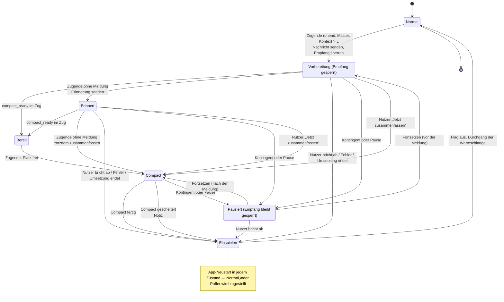

# 070 — Master-Session: Meldung und Annahme getrennt

**Status:** angenommen, Kern umgesetzt (Migration 30, Melden und Annehmen getrennt, Werkzeug `implementation_review_station`, Wecken am Zugende, Sperren für Stationen, Master wechseln, Bindings; Story Taiga #99, Phase 99.1); die Oberfläche (Phase 99.2) und die Abnahme in der echten App (99.A) stehen aus · **Datum:** 2026-11-17

## Kontext

Bisher meldete sich eine Station mit `implementation_complete_station` selbst fertig ([ADR 048](048-umsetzung.md), [ADR 061](061-constraint-ablaeufe.md)): Die Meldung war die Annahme, Nachfolger und Fix-Runde starteten sofort, und niemand prüfte, ob die Station wirklich fertig war. Die Session, die die Umsetzung angelegt hatte, hörte nur von einem Befund und vom Ende der Umsetzung ([ADR 061](061-constraint-ablaeufe.md), „Ersteller wecken“); eine Antwort ohne Meldung und ein Fehler erreichten sie nicht. Stationen konnten beliebigen Sessions schreiben und Sessions öffnen ([ADR 052](052-session-werkzeuge.md)). Der Benutzer hat am 2026-11-17 entschieden (U1 bis U9 der Story): Die Meldung geht an einen **Master**, der sie annimmt, zurückgibt oder freigibt.

## Entscheidung

Vom Benutzer entschieden:

- **U1:** Nach der Meldung ist die Station **gemeldet**. Der Master entscheidet erst, wenn ihr Zug beendet ist: Abgabe, Fehler oder Abbruch; eine Pause ist kein Zugende.
- **U2:** Ein Werkzeug des Masters mit drei Antworten: **annehmen** (Fix-Runde, Übergabe und Nachfolger laufen wie bisher mit der Meldung), **zurückgeben** (höchstens dreimal, danach entscheidet der Benutzer), **freigeben** (Stationen „durch dich“).
- **U3:** Der Verwalter weckt den Master bei jeder Meldung, jeder Rückfrage, jedem Fehler und jeder Antwort ohne Meldung einer Station.
- **U4:** Rückfragen und Rechte-Abfragen einer Station beantwortet weiter der Benutzer.
- **U5:** Kein `report_to_master`, kein `get_master_session`, kein `delegate`; die erste Nachricht der Station nennt den Master.
- **U6:** Die Meldung verlangt eine Notiz (`note`, 1 bis 1000 Zeichen); `result` bleibt der Betreff.
- **U7:** Stationen sprechen nur mit ihrem Master.
- **U8:** Fällt der Master aus (gelöscht, Fehler), bestimmt der Benutzer einen neuen; eine Kontingent-Pause ist kein Ausfall.
- **U9:** Die Leiste zeigt die Umsetzung als eine Zeile unter ihrem Master (Phase 99.2, ändert [ADR 065](065-stationen-in-der-sidebar.md)).

Gebaut in Phase 99.1 (Kern-Teile von D1 bis D12):

- **D1 — Datenmodell:** `completed_at` heißt jetzt „angenommen“; `is_done`, `is_due`, `may_start`, `stations_done`, `finished_at` und die Zeilen „Vorgänger“ der ersten Nachricht bleiben deshalb unverändert. Migration 30 fügt `implementation_stations` die Spalten `reported_at`, `report` (JSON: Betreff, Notiz, `fix_needed`, Übergabenotiz), `returns` (nicht leer, Standard 0) und `released_at` hinzu, `implementations` die Spalte `master_session_id`, gefüllt aus `created_by_session_id`; diese bleibt. Fertige Stationen bleiben fertig, der Master einer laufenden Umsetzung ist ihr Ersteller (D12).
- **D2 — Melden:** `implementation_complete_station` prüft wie früher (Station der eigenen Session, Umsetzung nicht abgebrochen, Station nicht angenommen, `handoff` gültig für die Nachfolger von jetzt), verlangt `note` und speichert nur die Meldung; eine zweite vor der Entscheidung ersetzt die erste. Die Antwort: „Gemeldet. Dein Master entscheidet, sobald dein Zug beendet ist.“ Nichts wird geplant, kein Nachfolger startet vor der Annahme (löst Issue 57).
- **D3 — Annehmen:** `accept_station` läuft die Schritte der früheren Fertigmeldung (`complete_station_with_handoff`: Prüfen, Übergabe, eine Transaktion, Zeitgeber aus, Aufträge der Nachfolger, Weiterplanen) mit der gespeicherten Meldung. Erlaubt nur, wenn die Station gemeldet ist und ihr Zug beendet ist (`master::turn_ended`: Abgabe ohne wartendes Skript, ohne wartenden Subagenten und ohne Weitermachen von selbst; Fehler; Abbruch). Sonst sagt der Satz, dass der Verwalter erneut weckt. Die Transaktion schreibt nur, solange die Station nicht angenommen ist und die Meldung noch liegt: Zwei gleichzeitige Annahmen und eine Annahme nach einer Rückgabe schreiben nichts. Dieselbe Transaktion löscht, wenn sie eine Zeile getroffen hat, die noch wartenden Weck-Zeilen dieser Station aus dem Posteingang des Masters (`session_inbox::delete_wakes_of_station`; „Als fertig markieren“ eingeschlossen): Die Meldung ist entschieden, ihr Wecken verfällt (Issue 179). Gelöscht wird eine Zeile des Absenders `verwalter` nur, wenn ihr Text mit dem festen Anfang der Weck-Nachrichten zu einer Station beginnt (`wake::STATION_WAKE_START`) und ihre erste Kennung `(station_id: …)` die dieser Station ist; die Nachricht an einen neuen Master und die zum Ende der Umsetzung beginnen anders und bleiben, ebenso eine Zeile, die die Kennung erst im Betreff oder in der Notiz einer anderen Station nennt.
- **D4 — Zurückgeben:** verlangt eine Nachricht (1 bis 4000 Zeichen), löscht die Meldung, zählt `returns` hoch (nur, wenn noch der gelesene Stand gezählt ist), löscht in derselben Transaktion die wartenden Weck-Zeilen dieser Station aus dem Posteingang des Masters (Issue 179, Bedingungen wie bei D3) und stellt die Nachricht zu; an eine Station mit Fehler oder Abbruch geht sie über Neustart und Senden. Ab `returns = 3` lehnt das Werkzeug ab; die Station steht dann auf „wartet auf dich“, und der Benutzer nimmt an oder gibt zurück (Befehle `implementation_accept_station` und `implementation_return_station`, nur bei verbrauchten Rückgaben, danach ohne Grenze).
- **D5 — Freigeben:** nur für eine Station „durch dich“, die an der Reihe ist; setzt `released_at` und sonst nichts.
- **D6 — Ein Werkzeug:** `implementation_review_station { station_id, answer: "accept" | "return" | "release", message? }` in `ImplementationTools` (also in Claude, LM Studio und Autark), nur für den Master der Umsetzung, in Nebenfragen gesperrt, `blocks()` bleibt false. Die Antworten nennen das Ergebnis, bei `accept` die gestarteten Nachfolger.
- **D7 — Wecken am Zugende:** Alle Ereignisse außer der Rückfrage entstehen in `station_session_ended`, wenn der Zug wirklich beendet ist (nicht bei Pause, wartendem Skript oder Subagenten, scharfem Zeitgeber, anstehendem Neustart nach „Bei Fehler“): **Gemeldet** (Betreff, Befund, Notiz), **ohne Meldung** (Schluss der letzten Antwort, 200 Zeichen), **Fehler** oder **gestoppt**. „Fertig“ weckt nur, wenn der Benutzer die letzte Station angenommen hat. Der Schlüssel eines Ereignisses trägt Zähler (Rückgaben und Zug, die Zeit der letzten Aktivität der Session), damit eine Meldung nach einer Rückgabe und ein neuer Zug wieder wecken, ein zweiter Haken desselben Zugendes nicht. Die Entscheidung ist `wake::event_after_turn`, rein. Eine Weck-Zeile, die im Posteingang wartet, weil der Master beschäftigt oder das Tor voll war, verfällt, sobald er die Meldung der Station annimmt oder zurückgibt (D3, D4): Sonst käme sie nach der Entscheidung an und weckte ihn für nichts. Erkannt wird sie wie in D3: am Absender `verwalter`, am festen Anfang der Weck-Nachrichten zu einer Station (`wake::STATION_WAKE_START`) und daran, dass die erste `(station_id: <ID>` im Text die der Station ist, gefolgt von `)` oder, beim Hinweis „Unterbrochen“, von `,`; der Wortlaut ändert sich nicht, eine Spalte oder Migration gibt es nicht. Bleibt offen (Grenze): Weck-Zeilen nach dem Abbrechen einer Umsetzung (`cancel`) oder einem Wechsel des Masters (`set_master`) und eine Weck-Nachricht, die schon zugestellt ist.
- **D9 — Sperren für Stationen** (nur Betriebsart Claude): `verwalter_send_message_to` mit einem anderen Ziel als dem Master und `verwalter_open_session` lehnt der Core mit einem Satz ab, der den Master nennt („Session #N „Titel“, ID …“). Die Sperre sitzt im Sendeweg und vor dem Kasten, nicht in `tool_target`; `get_sessions` und `get_tldr` bleiben offen. Erst die Session (kurz), dann die Datenbank.
- **D10 — Erste Nachricht:** nennt den Master und sagt, dass die Meldung mit Notiz der Bericht an ihn ist und eine Antwort ohne Meldung an ihn geht.
- **D11 — Master wechseln:** Befehl `implementation_set_master(id, masterSessionId)` (Klasse C, die Klasse prüft `masterSessionId` als Session-ID): dasselbe Vorhaben, keine Station; der neue Master bekommt eine Nachricht mit der Umsetzung und den offenen Meldungen. Die Ansicht trägt `masterSessionId` und `masterMissing` (Session gelöscht, im Fehler oder nie gesetzt; eine Kontingent-Pause zählt nicht).

Die Ansicht trägt `StationState::Reported` (Wire `reported`, Dringlichkeit wie `running`), `report`, `returns`, `returnsLeft` und `released`. Eine gemeldete Station mit `returnsLeft = 0` hat den Zustand `waitsForYou`. Eine Rückfrage geht vor „gemeldet“: Der Benutzer muss sie beantworten.

## Was das in früheren ADRs überholt

- **[ADR 048](048-umsetzung.md):** „fertig mit Fertigmeldung“ und die Werkzeugliste: Fertig heißt angenommen, die Meldung ist nur der Bericht; das Werkzeug `implementation_review_station` kommt hinzu.
- **[ADR 061](061-constraint-ablaeufe.md):** „Ersteller wecken“ wird **Master wecken** (Ereignisse, Schlüssel, Wortlaut, siehe unten); `Finding` geht in „Gemeldet“ auf. Die Übergabenotiz wirkt erst mit der Annahme.

## Was sie ergänzt

- **[ADR 052](052-session-werkzeuge.md):** die Sperren für Stationen.
- **[ADR 062](062-plane-vorhaben.md):** Die planende Session, die die Umsetzung anlegt, ist ihr Master.
- **[ADR 046](046-mcp-zugang.md):** Codex hat keinen MCP-Zugang des Verwalters und damit weder das Werkzeug des Masters noch die Meldung mit Notiz.

## Wortlaut und Messung

Der Wortlaut steht fest in `wake.rs`: ein Satz je Ereignis mit der Quelle („Meldung des Verwalters“), der Umsetzung („die du leitest“), Lane und Stufe und, je nach Ereignis, Betreff und Notiz der Meldung, dem Schluss der letzten Antwort (auf eine Zeile und 200 Zeichen) oder der Frage. Er sagt, was geschah, nennt bei einer Meldung das Werkzeug `implementation_review_station` und sagt nicht, dass er keine Anweisung sei: Der Satz „keine Anweisung des Nutzers“ ließ Haiku verweigern ([ADR 052](052-session-werkzeuge.md), [ADR 061](061-constraint-ablaeufe.md)). Die Nachricht an einen neuen Master nennt die Umsetzung und die offenen Meldungen (`wake::new_master_message`).

**Messung** (Verfahren wie in [ADR 061](061-constraint-ablaeufe.md)): am 2026-11-17 mit `claude -p --model haiku` (Version 2.1.296), ohne Werkzeuge (`--tools ""`), ohne Einstellungen (`--setting-sources ""`, ohne Sitzungsspeicher, ohne Befehle), die `CLAUDE*`-Variablen der Umgebung entfernt, mit dem Systemprompt der Session-Werkzeuge (`session_tools_prompt`, jetzt mit dem Satz zum Master) und der Nachricht samt erster Zeile `[Nachricht von Session 0 „Verwalter“, ID verwalter]`; die Texte schreibt `implementation-probe --wake-texts`. Je Ereignis drei Läufe, gezählt wird, ob Haiku den Text annimmt (nicht „kommt nicht vom Nutzer“, keine Rückfrage nach der Quelle):

| Ereignis | Läufe | verweigert | Verhalten |
| :- | :- | :- | :- |
| Gemeldet, ohne Befund | 3 | 0 | dreimal als Entscheidung behandelt (zweimal zurückgeben, einmal offen); das Werkzeug fehlt in der Messung |
| Gemeldet, mit Befund (`fix_needed`) | 3 | 0 | dreimal Fix-Runde bzw. „zurückgeben“ empfohlen; ein erfundener Aufruf |
| Ohne Meldung | 3 | 0 | dreimal Stand der Station prüfen wollen (`verwalter_get_sessions`, TL;DR); zwei erfundene Aufrufe |
| Fehler | 3 | 0 | dreimal Stand prüfen wollen; zwei erfundene Aufrufe |
| Gestoppt | 3 | 0 | dreimal zur Kenntnis genommen, Stand prüfen wollen |
| Fertig | 3 | 0 | dreimal zur Kenntnis genommen, ohne Aktion |
| Rückfrage (Wortlaut „die du leitest“ statt „angelegt hast“) | 3 | 0 | dreimal an den Benutzer weitergegeben, nicht selbst entschieden |
| Nachricht an einen neuen Master | 3 | 0 | dreimal als Übernahme gelesen, die offene Meldung wollte er prüfen und dann entscheiden |

**Von Hand fertig** (Taiga-Story 97, `implementation::wake`, `--wake-texts` schreibt `marked-done`): Der Benutzer markiert eine Station im Fehler oder in einer Pause von Hand als fertig ([ADR 048](048-umsetzung.md)). Das Ereignis weckt den Master einmal je Markieren (Schlüssel `marked_done:<Station>`) und nur, wenn die Umsetzung einen Master hat; war es die letzte Station, folgt „Fertig“ wie nach einer Annahme. Messung wie oben (Haiku der Kommandozeile, `--tools ""`, `--setting-sources ""`, Wegwerf-`HOME` mit verlinktem `.claude`, ohne `CLAUDE*`-Variablen, Systemprompt `prompt.txt`, Nachricht `marked-done`), 2026-11-19; gezählt wird, ob Haiku verweigert und ob er ankündigt, anzunehmen, zurückzugeben oder freizugeben, oder ein Werkzeug dafür aufruft (ein Satz, dass nichts zu tun ist, zählt nicht):

| Fassung | Läufe | verweigert | kündigt Annahme, Rückgabe oder Freigabe an | Verhalten |
| :- | :- | :- | :- | :- |
| 1: „… als fertig markiert. Ergebnis: „…““ | 6 | 0 | 6 | sechsmal „ich nehme sie als Master an“ über `implementation_review_station`; einmal erst prüfen und dann annehmen, zurückgeben oder freigeben |
| 2: Fassung 1 plus „Damit gilt sie als angenommen; es gibt nichts zu entscheiden.“ | 6 | 0 | 0 | sechsmal zur Kenntnis genommen („gilt als angenommen, nichts zu entscheiden“), keine Aktion, kein Werkzeug |

Der Wortlaut steht fest in Fassung 2; die Rohdaten beider Fassungen liegen im Scratchpad der Umsetzungs-Session. Wie bei den anderen Messungen belegt sie nur, dass der Master den Text annimmt, nicht, dass er sonst richtig entscheidet; Werkzeuge fehlten in der Messung.

Nachtrag **Unterbrochen** (Fix round 3, Wortlaut `wake.rs`, `--wake-texts`, Haiku der Kommandozeile 2.1.296, 2026-11-17): Der Text nennt wie „Gemeldet“ die Wege des Masters als Möglichkeit (`verwalter_send_message_to`, zählt keine Rückgabe; `implementation_review_station` zurückgeben; der Benutzer kann fortsetzen) und gibt keinen Auftrag. Drei Läufe ohne Werkzeuge: 0 Verweigerungen, 3 von 3 „wartet nur“ (kein Aufruf, Nachricht oder Rückgabe wird nur angeboten). Drei Läufe mit den Schemas von `verwalter_send_message_to` und `implementation_review_station` als Text im Prompt: 3 von 3 „kein Aufruf“, 0 Nachrichten an die Station, 0 Rückgaben, 0 falsche Aufrufe. Zweimal begründete Haiku, ihm fehle die Session-ID der Station für `verwalter_send_message_to`. **Bekannte Grenze:** Der Master wartet auf „Unterbrochen“ in der Regel, statt der Station zu schreiben; das ist gewollt (kein Auftrag) und ungefährlich, denn die Annahme bleibt bis zum Zugende abgelehnt und die Station setzt mit der nächsten Nachricht oder dem Benutzer fort. Es folgt keine weitere Umformulierung. **Nachtrag zum Nachtrag** (Fix round 3, Nachtrag; derselbe Haiku, 2026-11-17): Die Nachricht nennt jetzt die Session der Station (`station_id: …, Session #N, ID <uuid>`), weil `verwalter_send_message_to` `session_ids` verlangt und Haiku das Fehlen zweimal als Grund nannte, nichts zu tun. Drei Läufe ohne Werkzeuge: 0 Verweigerungen, 2 „wartet nur“ (beide mit dem Hinweis, in diesem Lauf stünden keine Werkzeuge bereit), 1 Nachricht an die Station mit der genannten ID. Drei Läufe mit den Schemas beider Werkzeuge als Text: 1 Nachricht an die Station (`session_ids` mit der genannten ID), 2 „kein Aufruf“, 0 Rückgaben, 0 falsche Aufrufe. Insgesamt 2 Nachrichten und 4 „wartet nur“ von 6; die Grenze bleibt, der Wortlaut bleibt (keine weitere Umformulierung). „Ohne Meldung“ nennt `verwalter_send_message_to` nicht als Weg und blieb unverändert.

0 von 24 Läufen verweigerten; es war keine Umformulierung nötig. Eine erste Fassung ohne Kennung der Station wurde in der Fix-Runde ergänzt: Die Meldungen „Gemeldet“, „Ohne Meldung“, „Fehler“ und „Gestoppt“ sowie die Nachricht an einen neuen Master nennen jetzt `(station_id: …)`, die der Master für `implementation_review_station` braucht; die Messung der Tabelle wurde mit dieser Fassung wiederholt (CLI 2.1.296, je Ereignis drei Läufe, 0 Verweigerungen). Ein zweiter Lauf mit dem Schema von `implementation_review_station` als Text im Prompt (fünf Ereignisse, je drei Läufe) führte 15 von 15 Mal zu einem Aufruf mit der richtigen `station_id` (`s1`, bei der Nachricht an den neuen Master `st-7`). Mehrere Antworten sind durch die fehlenden Werkzeuge der Messung nicht verwertbar (erfundene Aufrufe, „Werkzeug nicht geladen“); die Messung belegt nur, dass der Master den Text annimmt, nicht, dass er richtig entscheidet. Die rohen Ausgaben liegen im Scratchpad der Umsetzungs-Session. Ein anderer Wortlaut braucht eine neue Messung. Nicht gemessen: der geänderte Satz zum Master im Planer-Prompt (`plan_prompt`) und in `session_tools_prompt`; die Messung des Planers (`plan-guard-probe`, [ADR 062](062-plane-vorhaben.md)) kostet Kontingent und folgt mit der Abnahme.

**Nachtrag 2026-11-22: Kennung statt Lane (Taiga-Story 192, [ADR 061](061-constraint-ablaeufe.md), Nachtrag 2026-11-22).** Die Weck-Texte und die Nachricht an einen neuen Master nennen die Station mit ihrer Anzeige `<Kennung> · <Stufe>` statt „Lane k · Stufe“, vor der `station_id`, etwa „… hat sich C-5 · Review (station_id: <uuid>) gemeldet …“ (`model::station_label`; `WakeFacts.lane` trägt jetzt die Kennung). `STATION_WAKE_START` und das Format „(station_id: …)“ bleiben, `delete_wakes_of_station` greift unverändert. `implementation_review_station` nimmt in `station_id` die `id` oder die Kennung einer Station der eigenen Umsetzung, etwa „C-5“ (Leerraum am Rand zählt nicht, `implementation::station_by_reference`); ist sie unbekannt, nennt der Fehler beide Formen. Die Antworten nennen die Station ebenso („Als Nächstes startet: C-6 · Fix-Runde.“).

Messung wie oben: 2026-11-22, `claude -p --model haiku` (Version 2.1.296), `--tools ""`, `--setting-sources ""`, `--no-session-persistence`, Wegwerf-`HOME` mit verlinktem `.claude`, ohne `CLAUDE*`-Variablen, Systemprompt `prompt.txt` als `--append-system-prompt`, Texte aus `implementation-probe --wake-texts` (Kennung „C-5“). Je geändertem Ereignis drei Läufe:

| Ereignis | Läufe | verweigert | Verhalten |
| :- | :- | :- | :- |
| Gemeldet, ohne Befund | 3 | 0 | zweimal erst prüfen (einmal ein erfundener Aufruf von `implementation_review_station` mit `station_id` s1), einmal „zurückgeben“ empfohlen |
| Gemeldet, mit Befund (`fix_needed`) | 3 | 0 | zweimal zurückgeben (erfundener Aufruf mit `station_id` s1), einmal erst prüfen |
| Ohne Meldung | 3 | 0 | einmal Stand prüfen wollen (erfundene Aufrufe), zweimal ohne Werkzeuge nichts entschieden |
| Fehler | 3 | 0 | dreimal Stand prüfen wollen; einmal erfundene Aufrufe |
| Gestoppt | 3 | 0 | dreimal zur Kenntnis genommen, Stand prüfen wollen |
| Fertig | 3 | 0 | dreimal zur Kenntnis genommen, ohne Aktion |
| Von Hand fertig | 3 | 0 | dreimal „gilt als angenommen“, kein Werkzeug |
| Rückfrage | 3 | 0 | dreimal nicht selbst entschieden, die Entscheidung liegt beim Benutzer |
| Unterbrochen | 3 | 0 | dreimal wartet auf das Zugende, nimmt nicht an |
| Nachricht an einen neuen Master | 3 | 0 | dreimal als Übernahme gelesen, die offene Meldung wollte er erst prüfen; zweimal erfundene Aufrufe |

0 von 30 Läufen verweigerten; der Wortlaut bleibt. Wie bisher belegt die Messung nur, dass der Master den Text annimmt; Werkzeuge fehlten. Nicht gemessen: die Fassung mit Referenz („Gemeldet“ mit `msg-<id>`, [ADR 072](072-nachrichten-ueber-referenzen.md)), die dafür eine Attrappe von `verwalter_read_message` braucht; ihr Satz um die Kennung ist derselbe. Die Rohdaten liegen im Scratchpad der Umsetzungs-Session.

## Oberfläche

Gebaut in Phase 99.2 nach dem Entwurf [`docs/design/2026-11-17_master-session/`](../design/2026-11-17_master-session/README.md); die Abweichungen stehen dort. Die Oberfläche zeigt, was der Core liefert (`state`, `report`, `returnsLeft`, `released`, `masterSessionId`, `masterMissing`), und rechnet keine Regel des Kerns nach.

- **Gemeldet:** eigene Farbe (`--color-status-reported`, hellblau) in Punkt, Zeile, Zeitleiste und Kartei; in der Dringlichkeit bleibt er wie „läuft“. Das Symbol der Umsetzung nimmt für ihn das von „läuft“. `waitingQueue` nimmt eine gemeldete Station erst bei `waitsForYou` auf.
- **Kartei:** Der Abschnitt „Bericht an den Master“ (`StationReportSection`) zeigt Betreff, Notiz, Befund, „gemeldet … · zurückgegeben n von 3“; ein Hinweis nennt den Master, auf den sie wartet. Bei erschöpften Rückgaben (`waitsForYou` mit Bericht und `returnsLeft = 0`) folgt „Du entscheidest“ mit „Annehmen“ und „Zurückgeben“; „Zurückgeben“ ist gesperrt, solange die Nachricht leer oder nur Leerzeichen ist. Fehler der Befehle erscheinen im Fehlerband der Umsetzung. Die Marke „vom Master freigegeben“ trägt die Kartei einer Station „durch dich“, die Zeitleiste „✓ freigegeben“ und „zurückgegeben n/3“.
- **Kopf:** „Master: #N Name · ändern“ (`MasterPicker`); „ändern“ öffnet ein `Popover` mit den Sessions des Vorhabens (Stationen gesperrt) und „Neue Session als Master“, das eine Session anlegt und sie zum Master macht. Bei `masterMissing` steht eine Warnleiste unter dem Kopf.
- **Leiste (U9, Variante A):** Die Umsetzung steht als eine Zeile unter der Session aus `masterSessionId`, darunter nur Stationen in `asking`, `waitsForYou` und `error`. Ohne Master, bei ausgefallenem Master (`masterMissing`) oder wenn die Session keine eigene Zeile im Vorhaben hat, bleibt sie im Vorhaben. Ein weggeklappter Master (gekürzte Liste ab `COLLAPSE_FROM`) bleibt sichtbar, damit er seine Umsetzung nicht versteckt. Die Regeln stehen in `src/app/sidebarPlacement.ts` (nur Typen, Selbsttest `sidebarPlacement.selftest.ts`). Die Rückfall-Markierung aus [ADR 065](065-stationen-in-der-sidebar.md) gilt weiter: Im Chat einer Station ohne eigene Zeile trägt die Umsetzung die Markierung.
- **Symbole (D17):** `StatusIcon` hat `shape: 'circle' | 'square'`; Umsetzungen nutzen `square` in Leiste und Kopf, mit derselben Formbedeutung und denselben Farben wie die runden Symbole.

## Zustand der Session an der Station (`live`, `pause`)

`state` bleibt, was der Ablauf braucht: Fortschritt, Nachfolger, Abschluss und das Wecken des Masters sehen `done` und `reported` unverändert. Daneben liefert `station_view` zwei Felder (Taiga #152, #38):

- **`live`** ist der Zustand der Session einer fertigen oder gemeldeten Station, solange sie nicht ruht: startet, läuft, wartet auf ein Skript, fragt, pausiert (mit scharfem Zeitgeber `waitsForQuota`, sonst `waitsForYou`) oder im Fehler. Eine abgegebene Session ohne Skript ruht (`null`). Bei einer fertigen Station gilt `live` nur, wenn die Session nach der Annahme aktiv war (`last_activity_at` über `completed_at`); eine Annahme setzt die Aktivität nicht selbst, ein alter Fehler zeigt sich also nicht.
- **`pause`** nennt den Grund, solange die Session pausiert ist: `quota` mit der Rücksetzzeit (oder ohne), sonst `other` (vom Benutzer pausiert oder nach dem Neustart der App, denn dann ist der Grund gelöscht, ADR 051 und 064).
- **Dringlichkeit:** `urgency` der Umsetzung ist das Maximum von `urgency_rank` über `state` und `live`.
- **Gemeldet und pausiert** (Hinweis 7 der Abnahme): Die Station bleibt `reported`, `live` ist `waitsForYou`; Zeile, Kartei und Leiste zeigen „gemeldet · pausiert“, das Dashboard eine Karte `paused`.
- **Oberfläche:** Eine fertige Station mit `live` behält den Haken in der Farbe der Session („fertig · läuft wieder“, „fertig · fragt dich“, „fertig · pausiert“, „fertig · Fehler“); eine pausierte nennt den Grund als Chip („Kontingent bis HH:MM“, „Kontingent“, bei `other` keiner). Das eckige Symbol einer fertigen Umsetzung, deren `urgency` nicht `done` ist, zeigt einen Haken in der Farbe der Dringlichkeit. Die Regeln stehen in `stationLive.ts`, ihre Fälle in `sidebarPlacement.selftest.ts`.

## Bekannte Grenzen

- **Compact-Zug und Leiste:** Während des Compact-Zugs ist der Status `running`: Die Leiste zeigt „läuft“, und die Antwortkarte des Masters fehlt für diese Sekunden; danach kehrt sie mit derselben `answer_at` zurück.
- **Codex:** Ohne MCP des Verwalters melden Stationen dort nicht, und ein Master dort entscheidet nicht; die Umsetzung braucht Claude, LM Studio oder Autark.
- **Notiz in der Nachricht:** Die Notiz steht bis zu den Referenzen (Story 147) vollständig in der Weck-Nachricht, höchstens 1000 Zeichen.
- **App-Neustart:** Das Wecken ist nur im Speicher gemerkt. Beim App-Start läuft deshalb ein Weckdurchgang (`wake_reported_on_start`): Er nimmt jede gemeldete, nicht angenommene Station einer laufenden Umsetzung (`wake::event_on_start`). Ist ihr Zug beendet, weckt er den Master mit „Gemeldet“ wie am Zugende. Der Neustart setzt eine laufende Station auf `paused` (`SessionState::restored`), und eine Pause ist kein Zugende (D7): Ist die Session `paused` und kein Zeitgeber „Automatisch fortsetzen“ scharf (`SessionState::waits_for_resume`; nach einem Neustart ist keiner scharf, auch eine Station, die vor dem Beenden am Kontingent pausierte, bekommt deshalb „Unterbrochen“), weckt er mit dem Ereignis **Unterbrochen** (Umsetzung, Lane, Stufe, `station_id`, die Session der Station („Session #N, ID …“), Betreff; der Zug ist unterbrochen, die Station setzt mit der nächsten Nachricht fort, angenommen wird erst nach ihrem Zugende; nennt die Wege des Masters als Möglichkeit, kein Auftrag). Der Durchgang unterscheidet nicht, ob die Pause vom Neustart oder vom Benutzer kommt. Ein scharfer Zeitgeber weckt nicht: Die Station setzt von selbst fort, und ihr Zugende weckt. Das Annehmen bleibt bis dahin abgelehnt (`TURN_NOT_ENDED`); der Master kann der Station mit `verwalter_send_message_to` schreiben (zählt keine Rückgabe) oder sie zurückgeben. Beides wird sofort zugestellt und setzt die pausierte Station fort (Befund der Abnahme 99.A: vorher blieb die Nachricht im Posteingang, bis der Benutzer „Fortsetzen“ klickte). Die Regel sitzt in `deliver` (`route_message`): Eine Nachricht des Masters an seine eigene Station, die pausiert ist und keinen scharfen Zeitgeber „Automatisch fortsetzen“ hat, geht sofort hinaus. Wie bisher warten Nachrichten anderer Absender an eine pausierte Session im Posteingang, setzt eine Station mit scharfem Zeitgeber von selbst fort, geht jede Zustellung durch das Tor der globalen Warteschlange (ADR 068; ohne Platz wartet sie, und eine ältere wartende Nachricht geht zuerst). Eine so eingereihte Nachricht des Masters holt der Durchgang ab, sobald ein Platz frei ist (`takes_oldest`): Er nimmt auch eine pausierte Station ohne scharfen Zeitgeber, in deren Posteingang eine Nachricht ihres Masters liegt, die seit Beginn der Pause (`paused_since`, gesetzt beim Wechsel nach `paused`; der Reaper löscht es nicht, ein Neustart setzt es auf den Ladezeitpunkt) einging, und stellt die älteste zu; eine Master-Nachricht, die vor der Pause eingereiht wurde (die Station lief noch), zählt nicht, damit eine Pause des Benutzers nicht von selbst endet; der Rest folgt am Zugende, und angenommen wird erst nach dem Zugende (D3). Der Wortlaut der Weck-Nachricht bleibt. Schlüssel von „Unterbrochen“: Station und `returns`, einmal je Lauf der App. Ein Zugende, das nur den Hintergrund ändert (Skript oder Subagent endet mit dem Prozess, der Status bleibt „abgegeben“), löst den Haken ebenfalls aus. Eine Station, die vor dem Neustart ohne Meldung endete, weckt nicht. Nach einem Neustart ist der Schlüssel der Weck-Ereignisse leer: Hörte der Master eine Meldung schon vor dem Neustart, hört er sie danach ein zweites Mal. Das ist gewollt; pro Lauf der App weckt jede Meldung höchstens einmal. Eine Weck-Zeile zu einer Station, die der Master inzwischen angenommen oder zurückgegeben hat, wartet dann nicht mehr im Posteingang (D3, D4).
- **Rückgabe ohne Zustellung:** Scheitert das Zustellen der Rückgabe nach dem Zählen (Session gelöscht), zählt sie trotzdem; der Fehlersatz des Werkzeugs sagt es.
- **Nummer:** 069 ist an „Zeitpunkt im Chat“ vergeben; diese ADR hat die Nummer 070 und fasst jene nicht an.

## Prüfung

Tests des Durchgangs mit echter Datenbank unter `sessions::registry::tests::` (Master-Nachricht nach der Pause genommen; vor der Pause, von einem anderen Absender und ohne Pausenbeginn nicht) und des Pausenbeginns (`paused_since`: beim Wechsel, nach dem Reaper, nach `restored`). Reine Funktionen unter `implementation::` (`master.rs`, `wake.rs`) mit Tests: Zugende (Pause, wartendes Skript oder Subagent), Annehmen vor dem Zugende, Grenze der Rückgaben, Freigeben, Master wechseln und ausfallen, die Sperren, Weck-Entscheidung samt Schlüssel; dazu Zustand und Ansicht, Schreiber der Datenbank (Ersatz einer Meldung, Rückgabe, zwei Annahmen), Migration 30, erste Nachricht, Klasse und `ids_of` der Befehle. `implementation-probe --selftest` hat Fälle für die Meldung mitten im Zug, das Annehmen vor dem Zugende, das Zurückgeben bis zur Grenze und den Masterwechsel mit offener Meldung; `--wake-texts` schreibt die Texte der Messung. Die Entscheidung der Zustellung (`route_message`, Tests unter `sessions::registry::tests::`) ist rein und getestet; die übrigen Wege unter `sessions/` (Sperren im Sendeweg, Neustart bei der Rückgabe) sind nur gelesen. Verfallende Weck-Zeilen (Issue 179): `accepting_or_returning_a_report_drops_the_waiting_wake_rows_of_that_station_only` (der echte Weck-Text aus `wake::decide`, Annehmen und Zurückgeben, die Zeile einer anderen Station, auch wenn ihre Notiz diese nennt, die Nachrichten an einen neuen Master, die Zeile ohne Station und die einer anderen Session bleiben, danach liefert der Posteingang zu dieser Station nichts mehr; `only_the_wakes_about_a_station_start_with_the_fixed_station_start` hält den festen Anfang an den Texten) und `a_refused_acceptance_or_return_leaves_the_wake_rows_waiting`.

### Nachtrag: Rückgabe, „Gemeldet“ und erste Nachricht über Referenzen ([ADR 072](072-nachrichten-ueber-referenzen.md))

Die Rückgabe des Masters (`implementation_review_station`, `return`) braucht `subject` und `message` und kommt bei der Station als Betreff mit Referenz an. Der Weck-Text „Gemeldet“ und „Gemeldet mit Befund“ behält seinen Wortlaut, nur die Notiz wird zur Referenz (`Notiz: msg-<id> (lies sie mit verwalter_read_message)`, Betreff der Zeile ist das Ergebnis). Die erste Nachricht einer Station behält `/<skill>` als erste Zeile, der Rest geht als Referenz mit dem Betreff `Auftrag: Lane <lane> · <stage> in „<Umsetzung>“`. Alle anderen Weck-Texte bleiben direkt.

## Nachtrag: Compact der ruhenden Master-Session (Taiga #100)

Ein Master lebt über lange Umsetzungen, sein Kontext wächst, bis jede Nachricht teuer wird. Deshalb schickt der Verwalter ihm `/compact` als eigenen Zug.

- **Einstellung:** `masterCompactTokens` (Schlüssel `master_compact_tokens`, Standard 150 000, erlaubt 50 000 bis 2 000 000, `null` = Aus), global, bei den Modellen. Eine Eingabe außerhalb der Grenzen lehnt der Core mit einem Satz ab; ein unlesbarer gespeicherter Wert gilt als Standard.
- **Regel (`sessions/registry/compact.rs`, `wanted`, rein):** Ein Zug endet mit `completed`, und die Session ist Master mindestens einer Umsetzung ohne Ende (weder fertig noch abgebrochen), ruht (`rests()`), hat keine wartende Nachricht im Posteingang, ihr `context_used` liegt über der Grenze, und sie läuft über die Claude-Kommandozeile (Claude oder LM Studio). Autark fasst selbst zusammen, Codex lässt sich nicht auslösen.
- **Weg:** Das Zugende setzt nur einen Merker im Ausgang (`Outbox::compact`, wie `plan_reminder`); nach dem Freigeben der Sperre prüft ein Thread Umsetzung, Einstellung und Betriebsart, geht durch das Tor der globalen Warteschlange ([ADR 068](068-globale-warteschlange.md)) und prüft unter der Session-Sperre erneut (Session vor Datenbank). Zuerst die billigen Bedingungen (Master, Grenze, Betriebsart; `may_apply`), ohne Netz und ohne Datenbank je Session, erst dann `prepare_turn`. Ohne freien Platz entfällt der Zug diesmal; ein gescheiterter Versuch kommt erst nach dem nächsten Zugende wieder. Höchstens einer je Zugende. Die Schritte vor dem Senden (`admit_compact`) und die Prüfung unter der Sperre (`decide_under_lock`) sind ohne `AppHandle` getestet.
- **Keine Eingabe, keine Antwort (`TurnOrigin::Compact`):** kein Benutzereintrag, kein `note_input`; `seen_at`, `auto_chain`, `answer_*` und `card_dismissed_at` bleiben. Das Zugende des Compact-Zugs ordnet nichts ein, setzt keine Antwort, löst keinen weiteren Compact aus und stellt `last_activity_at` und `seen_at` wieder her, denn der Wechsel nach `completed` würde die Session sonst ungelesen machen. Nachrichten, die während des Zugs kommen, warten im Posteingang wie bei jedem laufenden Zug; das Zugende lässt den Durchgang laufen.
- **Gescheiterter Compact-Zug:** Endet er mit Fehler, Kontingent oder Abbruch, ruht die Session wie vorher: Status `completed`, `last_activity_at` und `seen_at` unverändert, kein Ungelesen, keine Karte (ein Master im Fehler gilt als ausgefallen; eine Aufräumarbeit im Hintergrund darf das nicht auslösen). Der Chat zeigt „Zusammenfassen gescheitert: …“ mit dem Grund; der nächste Versuch kommt nach dem nächsten Zugende.
- **Pause im Compact-Zug:** Ist `pause_requested` gesetzt, endet der Zug auf dem gewöhnlichen Pausenweg (Status `paused`, der Merker wird zurückgesetzt); ein pausierter Master gilt nicht als ausgefallen. Ohne Pausenwunsch ruht ein gescheiterter Zug, auch dort ist der Merker danach `false`.
- **Hinweis:** `Notice::Compacted` hat `by_verwalter` (ältere Hinweise lesen sich als `false`). Der Chat zeigt „Verlauf zusammengefasst · automatisch durch den Verwalter“; die Kommandozeile meldet den Auslöser trotzdem als `manual`, deshalb ersetzt der Zusatz den Text „von Hand“. Der Knopf „Compact“ bleibt der Weg des Benutzers.
- **Kosten:** Ein Compact ist ein voller Modellaufruf über den ganzen Kontext und baut den Prompt-Cache neu auf; dafür kostet jede folgende Nachricht des Masters weniger.
- **Prüfung:** Tests unter `sessions::registry::tests::` (Regel mit Gegenfällen, Tor, kein Eingang, Zugende ohne Antwort, Einstellung, alter Hinweis, billige Prüfungen zuerst, Neuprüfung unter der Sperre, gescheiterter Compact-Zug, pausierter Compact-Zug, kein Pausenwunsch nach gescheitertem Zug).

### Nachtrag: Befehls-Stationen ([ADR 073](073-befehls-stationen.md))

Eine Befehls-Station meldet nicht: Ihr Erfolg ist eine Annahme ohne Meldung und ohne Wecken. Ein Fehler weckt den Master mit dem Weck-Text „Fehler“ (`WakeEvent::Failed`), „Abbrechen“ mit „gestoppt“; der Zug ist der Lauf, seine Marke der Beginn des Laufs.

## Nachtrag: Befunde der Abnahme NC.A (Taiga #175)

Der Probelauf zeigte: Eine Nachricht an einen laufenden Master blieb in 4 von 9 Läufen liegen, nach einem Compact zeigte die Session den alten Kontext, und „Compact“ von Hand hinterließ eine leere Karte „Antwort liegt vor“. Vier Regeln:

1. **Wer den Platz zurückgibt, lässt Wartende nachrücken:** Der Compact-Weg gibt den Platz an einer Stelle zurück (`give_back_slot`). Startet er keinen Compact-Zug (abgelehnt, etwa weil eine Nachricht wartet, oder gescheitert), stößt er einen Durchgang der Warteschlange an; sonst blieb die Session für den Durchgang des Zugendes „belegt“ und wurde übersprungen.
2. **Nur über der Grenze:** Der Weg beansprucht keinen Platz und ruft kein `prepare_turn` auf, solange `context_used` die Grenze nicht überschreitet (`admit_compact_over_limit`, `above_limit`): keine Abfrage je Session; gelesen werden nur die Einstellungen.
3. **Kontext nach dem Compact:** Meldet `compact_boundary` `post_tokens`, ist das der neue `context_used`; ohne Angabe (Agent „Autark“) bleibt er bis zur nächsten Meldung.
4. **`/compact` ist keine Antwort:** Ein Zug, dessen Eingabe nur `/compact` ist (Knopf oder getippt), setzt keine Antwort des Dashboards und lässt eine bestehende stehen (`compact_by_hand`, `enter_running` setzt ihn je Zug aus der Eingabe oder setzt ihn zurück; weder `start_turn` noch `push_user` setzen ihn). Er plant auch keine Einordnung ein: `end_turn` gibt dem Zugende mit `compact_by_hand` keinen Auftrag; ein wartender Auftrag des vorigen Zugs (`classify_next`) bleibt, weil nur `classify::schedule` ihn überschreibt und das nur mit einem Auftrag in der Outbox läuft (Issue 184).

Prüfung: `a_declined_compact_lets_the_waiting_message_through`, `a_failed_compact_lets_the_queue_move_on`, `no_compact_path_below_the_limit`, `the_compact_boundary_sets_the_new_context`, `a_compact_without_metadata_keeps_the_context`, `a_compact_turn_by_hand_gives_no_answer_card`, `a_failed_write_of_compact_leaves_the_next_turn_its_answer_card`, `the_reply_compact_to_a_question_keeps_the_answer_card_of_the_turn`, `a_compact_turn_by_hand_plans_no_classification`.

## Nachtrag 2026-11-21: „Erledigt“, Rückfrage und Marke der Freigabe (Taiga #136)

- **„Erledigt“ in der Zeile:** Eine Station „durch dich“, die an der Reihe ist, trägt in der Zeile der Zeitleiste „Erledigt“ vor „Öffnen“; ein Klick schließt mit dem Standardtext „vom Benutzer erledigt“ ab. Das Ergebnisfeld bleibt in der Kartei. Freigegeben ist „Erledigt“ hervorgehoben.
- **Rückfrage ohne Freigabe:** Hat die Umsetzung einen Master und hat er die Station nicht freigegeben, fragt jeder Weg zu „Erledigt“ einmal nach: „Der Master hat diese Station nicht freigegeben. Trotzdem erledigt?“, gleich in Zeile, Kartei und Popup (`asksBeforeDone` in `stationControls.ts`, Selbsttest). Ohne Master fragt keiner. Der Core prüft weiter nur, dass die Station „durch dich“ ist.
- **Marke der Freigabe:** „✓ freigegeben“ als Chip in der zweiten Zeile der Station in der Leiste, „✓ vom Master freigegeben“ an der Karte im Dashboard (Variante A des Entwurfs).
- **Antwort auf `accept`:** Der bisherige Text bleibt; dahinter nennt `CompleteOutcome::text` die Stationen „durch dich“, die jetzt an der Reihe sind, mit Lane, Stufe und `id` (`due_for_user`, dieselbe Regel wie `release`), damit der Master sie freigeben kann. Prüfung: `acceptance_names_the_stations_by_you_that_are_due_with_id_and_stage`.

## Nachtrag 2026-11-25: Umsetzungen je Session ([ADR 076](076-umsetzungen-je-session.md), Taiga #217)

- **D9:** `verwalter_open_session` gibt es nicht mehr (ADR 076); die Sperre `open_refusal` entfällt. Stattdessen legt eine Station keine Umsetzung an: `implementation_create` lehnt mit „Eine Station legt keine Umsetzung an. Melde dein Ergebnis mit implementation_complete_station.“ ab.
- **D11:** Ein Masterwechsel auf eine Session, die schon eine unfertige Umsetzung führt, wird abgelehnt („Die Session führt schon die Umsetzung „…“.“); der `MasterPicker` sperrt sie mit „führt schon „…““.

## Nachtrag 2026-11-25: Compact mit Vorbereitung (Taiga #215)

Der Compact aus dem Nachtrag „Compact der ruhenden Master-Session“ kam ohne Vorwarnung: Die Session konnte ihren Stand nicht sichern, und Nachrichten, die während des Compact-Zugs eintrafen, gingen ohne Ordnung in den laufenden Zug. Jetzt bittet der Verwalter den Master zuerst, sich vorzubereiten, und sperrt bis zum Ende des Compacts den Empfang. Entscheidungen des Benutzers und Empfehlungen der Planung 0.78.0 (C1 bis C9); Entwurf und Klick-Prototyp in `docs/design/2026-11-25_compact-vorbereitung/`.

- **C1, nur ruhend:** Der Ablauf beginnt wie die Regel `wanted`: Zugende `completed`, kein Compact-Zug, Master einer unfertigen Umsetzung, `rests()`, leerer Posteingang, `context_used` über der Grenze. Statt `/compact` schickt der Verwalter die Bitte als Zug (Absender „Verwalter“, Nr. 0, wie die Weck-Nachrichten, aber ohne Referenz, damit der Text selbst ankommt): „Du bist über dem Limit von {L} Tokens Kontext. Bereite dich auf /compact vor und melde dich mit einem Aufruf von mcp__verwalter__verwalter_compact_ready beim Verwalter zurück.“ Mit der Bitte beginnt die **Sperre**.
- **C2, Werkzeug:** `verwalter_compact_ready` in `SessionTools`, für alle Sessions der Betriebsart Claude sichtbar, Teil von Satz 1 in `session_tools_prompt` (V1). In der Vorbereitung antwortet es „Gemeldet. Der Compact folgt, wenn dein Zug endet.“, sonst „Gerade steht kein Compact an.“ Eine Nebenfrage darf es nicht rufen.
- **C3, keine Meldung:** Endet der Vorbereitungszug ohne Meldung, kommt einmal die Erinnerung („Du hast dich noch nicht mit mcp__verwalter__verwalter_compact_ready gemeldet. Sichere deinen Stand und ruf das Werkzeug auf; endet dieser Zug ohne Aufruf, fasse ich trotzdem zusammen.“). Endet auch dieser Zug ohne Meldung, fasst der Verwalter trotzdem zusammen. Der Vorbereitungszug löst keine zweite Bitte aus: `decide_under_lock` sieht die Phase (`after_compact`).
- **C4, Compact scheitert:** Notiz „Zusammenfassen gescheitert: …“ wie bisher; die Sperre geht trotzdem weg.
- **C5, Sperre:** Ab dem Senden der Bitte geht keine Nachricht mehr in die Session, weder vom Nutzer noch von Sessions noch vom Verwalter, auch kein automatisches `send`. Die Zeilen bleiben in `session_inbox` (`waitsFor: compact`, V3 aus ADR 078). Die Sperrstellen sind `route_input` (eigene Nachricht: `InputRoute::Queue`; die Antwort auf eine offene Rückfrage geht weiter), `route_message` über `compact::locked_route` (kein Anstoß), `takes_oldest` und `takes_user_messages` (der Durchgang holt nichts ab), `user_release` (`Later`), „Jetzt senden“ (`refuse_send_now` mit dem Satz der Leiste), die automatischen `send`-Wege über `refuses_start` (Plan, Station, Erinnerung des Wächters) und der Plan-Wächter selbst. Nur das Fortsetzen einer pausierten Session darf hinein. Die Oberfläche: Leiste über dem Eingabefeld statt `QueuedHint` (ohne „Jetzt senden“), Marke „wartet · bis der Compact fertig ist“ an der eigenen Blase, im Kontext-Panel heißt „Compact“ „Jetzt zusammenfassen“, Kopfzeile und Sidebar zeigen „⧗ …“.
- **C6, Einspielen:** Es gibt keinen eigenen Puffer. Wenn die Phase endet, ruft `update` einen Durchgang der Warteschlange und meldet `inbox://changed`. Eigene Nachrichten gehen zusammen hinaus, fremde je Zugende. Fertig, gescheitert, abgebrochen, Fehler, Abbruch der Session und Ende der Umsetzung (`end_compact_of_implementation`, auch beim Abbruch) heben die Sperre auf; ein laufender Compact-Zug endet erst.
- **C7, Betriebsart:** Nur Claude (`OperatingMode::Claude`). Claude Code + LM Studio hat die Session-Werkzeuge nicht; es bekommt wie bisher gleich `/compact` ohne Sperre.
- **C8, Zustand:** Die Phase liegt nur im Speicher (`SessionState::compact_phase`) und geht als `compactPhase` an `SessionSummary` (`#[serde(default)]`, im TS-Typ optional); `SessionStatus` bekommt keine Variante. Nach einem Neustart ist sie weg, die Nachrichten gehen hinaus, die Regel greift beim nächsten Zugende neu.
- **C9, Platz:** Nach der Meldung geht der Compact nicht mehr verloren, weil kein Platz frei ist: `compact_waits_for_slot` macht die Session zum Wartenden der Art `Resume` in der Warteschlange (Vorrang eines Fortsetzens, ADR 068, Nachtrag E3), und `resume_or_compact_claimed` startet den Schritt mit dem Platz des Durchgangs. Dasselbe gilt für die Erinnerung. Die Bitte selbst entfällt ohne Platz wie bisher der Compact und kommt beim nächsten Zugende.
- **Pause:** Kontingent oder Nutzer halten die Session an, die Sperre bleibt (auch bei einem Compact-Zug im Kontingent; ohne Phase bleibt dort das Verhalten von heute). Fortsetzen (von Hand oder mit dem Zeitgeber) kehrt in den Zustand davor zurück: vor der Meldung geht der Fortsetz-Text, danach startet der Compact-Zug (`send_resume`).
- **Nutzer:** „Jetzt zusammenfassen“ (`chat_compact_now`) gibt den Compact frei, ohne die Meldung abzuwarten; „Compact abbrechen“ (`chat_compact_abort`) hebt die Sperre auf, auch in der Pause. Beide Befehle sind Klasse C für Gäste. Ein laufender Compact-Zug lässt sich nicht abbrechen.

### Zustandsdiagramm

### Messung (F4)

Die Bitte und die Erinnerung sind mit `compact-probe` an Haiku gemessen (Claude Code 2.1.296, Modell `claude-haiku-5-5`, je Lauf zwei Züge: ein Arbeitsstand ohne Werkzeug, dann die Nachricht mit der Kopfzeile des Core; das Werkzeug beantwortet ein MCP-Stand-in mit dem Satz der App): **Bitte 18 von 18**: Alle 18 Läufe riefen `verwalter_compact_ready` ohne Verweigerung. **Erinnerung 18 von 18**, ebenso. Keine Fehler, keine Zeitüberschreitung, Kosten 0,147 USD für die 36 Läufe. Wortlaut der Bitte (L = 150 000): „Du bist über dem Limit von 150 000 Tokens Kontext. Bereite dich auf /compact vor und melde dich mit einem Aufruf von mcp__verwalter__verwalter_compact_ready beim Verwalter zurück.“ Wortlaut der Erinnerung wie unter C3. Der volle Name des Werkzeugs steht in beiden Texten, weil Haiku aufgeschobene Werkzeuge sonst erst laden müsste. Die Läufe stehen in `docs/design/2026-11-25_compact-vorbereitung/umsetzung/` (`haiku-messung.txt`, `haiku-messung-runs.jsonl`).

Bei der Erinnerung fehlt dem Agenten die Bitte im Verlauf; in der App steht sie davor. Der Wortlaut stützt sich nicht auf sie.

### Bekannte Grenzen

- Die Phase gilt nur im Speicher; stürzt die App im Compact ab, ist der Empfang danach offen, und der Compact-Zug, der läuft, endet mit dem Prozess.
- „Jetzt zusammenfassen“ steht während der Pause nicht zur Verfügung; der Nutzer setzt fort oder bricht ab.
- Meldet sich ein Master in der Vorbereitung mit `verwalter_notify_user` und fragt (`questions`), wartet seine Rückfrage auf die Antwort; die Antwort geht hinein, jede andere Nachricht wartet.

Prüfung: Tests unter `sessions::registry::tests::` (`cargo test --manifest-path src-tauri/Cargo.toml --lib compact`): je Übergang des Diagramms einer, dessen Name den Übergang nennt (`normal_to_preparation_…`, `preparation_to_ready_…`, `preparation_to_reminded_…`, `reminded_to_ready_…`, `reminded_to_compact_…`, `ready_to_compact_…`, `compact_to_replay_…`, `preparation_to_replay_…`, `paused_to_…`, `preparation_to_paused_…`, `compact_to_paused_…`, `preparation_to_compact_when_the_user_says_now`), keine Nachricht geht während der Sperre hinein je Sperrstelle (`no_message_of_the_user_goes_in_…`, `a_message_of_another_session_or_the_verwalter_waits_…`, `the_pass_collects_no_waiting_message_…`, `a_waiting_message_of_the_user_is_not_released_…`, `no_automatic_send_goes_in_…`, `the_messages_in_the_inbox_name_the_compact_…`), `after_the_compact_the_own_messages_go_together_before_the_foreign_ones`, `no_second_preparation_while_the_session_is_in_the_compact`, `the_compact_after_the_report_waits_for_a_slot_like_a_resume`, `a_restart_lifts_the_lock_because_the_phase_lives_only_in_memory`, `the_request_names_the_limit_in_groups_and_the_full_tool_name`; dazu `compactTexts.selftest.ts` (`pnpm selftest`) und `compact-probe --selftest`.
