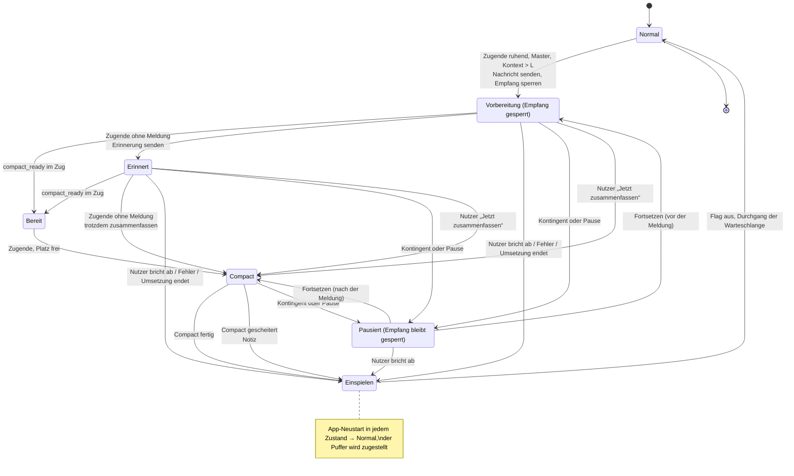

# Master-Compact mit Vorbereitung (Taiga-Story 215)

`mockup.html` ist der eigenständige Klick-Prototyp (hell und dunkel, die Ereignisse oben schalten die Zustände des Diagramms). Entscheidungen und Messung stehen im Nachtrag „Compact mit Vorbereitung“ in [ADR 070](../../decisions/070-master-session.md), die Sperre im Nachtrag zu [ADR 068](../../decisions/068-globale-warteschlange.md). Belege der Probeläufe liegen unter `umsetzung/`.

## Entscheidungen

- **C1 Nur ruhend.** Ruht ein Master einer unfertigen Umsetzung über „Master zusammenfassen ab“, schickt der Verwalter nicht gleich `/compact`, sondern bittet ihn, sich vorzubereiten. Bis er sich meldet und der Compact durch ist, warten alle Nachrichten an ihn.
- **C2 Werkzeug.** `verwalter_compact_ready` in `SessionTools`, für alle sichtbar. Außerhalb der Vorbereitung antwortet es „Gerade steht kein Compact an.“, in der Vorbereitung „Gemeldet. Der Compact folgt, wenn dein Zug endet.“ Die Bitte nennt den vollen Namen `mcp__verwalter__verwalter_compact_ready`.
- **C3 Keine Meldung.** Endet der Vorbereitungszug ohne Meldung, kommt einmal eine Erinnerung. Endet auch dieser Zug ohne Meldung, fasst der Verwalter trotzdem zusammen. Der Nutzer kann jederzeit „Jetzt zusammenfassen“ oder „Compact abbrechen“ wählen. Bricht er ab, während ein Zug der Vorbereitung läuft, löst dessen Ende keine neue Bitte aus (ein Merker, nur für dieses Zugende); die Regel gilt danach wieder wie im Diagramm. Bitte und Erinnerung tragen im Chat die Betreffe „Compact vorbereiten“ und „Erinnerung: Compact“; der Text an den Agenten bleibt wörtlich der gemessene.
- **C4 Scheitert der Compact,** gehen die wartenden Nachrichten trotzdem hinaus; die Notiz lautet wie heute „Zusammenfassen gescheitert: …“.
- **C5 Sichtbar.** Die eigene wartende Blase trägt „wartet · bis der Compact fertig ist“, fremde Nachrichten tragen „bis der Compact fertig ist“ als Grund (Reiter „Nachrichten“, Hinweis im Chat). Über dem Eingabefeld steht die Leiste „Die Session bereitet einen Compact vor. Nachrichten warten, bis er fertig ist.“ mit „Jetzt zusammenfassen“ und „Compact abbrechen“; „Jetzt senden“ gibt es in diesem Zustand nicht. Im Kontext-Panel heißt „Compact“ „Jetzt zusammenfassen“. Kopfzeile und Sidebar zeigen „⧗ <Zustand>“.
- **C6 Einspielen** gibt es nicht als eigenen Puffer: Die Nachrichten liegen schon in `session_inbox`. Die Sperre fällt, und ein Durchgang der Warteschlange stellt zu; Neues reiht sich hinter Älteres. Eigene Nachrichten gehen zusammen, fremde je Zugende.
- **C7 Betriebsart.** Nur Claude. Claude Code + LM Studio hat die Werkzeuge nicht und bekommt wie bisher gleich `/compact`.
- **C8 Zustand** nur im Speicher: ein Feld `compactPhase` an `SessionSummary` (keine neue `SessionStatus`-Variante). Nach einem Neustart ist er weg, die Nachrichten gehen hinaus, die Regel greift beim nächsten Zugende neu.
- **C9 Platz.** Nach der Meldung geht der Compact nicht mehr verloren, weil kein Platz frei ist: Er wartet in der Warteschlange mit dem Vorrang eines Fortsetzens und mit festem Beginn des Wartens (der erste Durchgang, der ihn sieht), damit er vor später eingegangene Nachrichten rückt.

Nicht umgesetzt vom Prototyp: die Notizen des Einspielens („n eigene Nachrichten zusammen zugestellt“, „Zugestellt: …“); sie bräuchten einen eigenen Weg an der Zustellung.

## Die Sperre

Ab dem Senden der Bitte geht nichts mehr in die Session (`SessionState::compact_locked`):

| Sperrstelle | Wirkung |
| :- | :- |
| `route_input` (eigene Nachricht, `chat_send`) | wartet immer (`InputRoute::Queue`); eine Antwort auf eine offene Rückfrage geht weiter |
| `route_message` (andere Sessions, Verwalter) | `locked_route`: wartet, kein Anstoß |
| `takes_oldest`, `takes_user_messages` | der Durchgang holt nichts ab |
| `user_release` | `Later`; „Jetzt senden“ (`refuses_now`) lehnt mit dem Satz der Leiste ab |
| automatische `send`-Wege (Plan, Station, Erinnerung des Wächters) | `refuses_start`; nur das Fortsetzen einer pausierten Session darf hinein |

## Zustandsdiagramm

`Vorbereitung` ist `CompactPhase::Preparing`, `Erinnert` ist `Reminded`, `Bereit` ist `Ready`, `Compact` ist `Compacting`; „Pausiert“ ist der Status `Paused` mit unveränderter Phase, „Einspielen“ der Augenblick, in dem die Phase `None` wird und der Durchgang läuft.

Abweichungen vom Diagramm der Planung: keine. Zwei Festlegungen, die es offen ließ: Ein laufender Compact-Zug lässt sich nicht abbrechen („Compact abbrechen“ erscheint dort nicht); die Umsetzung, die endet, beendet nur die Phasen vor dem Compact.
